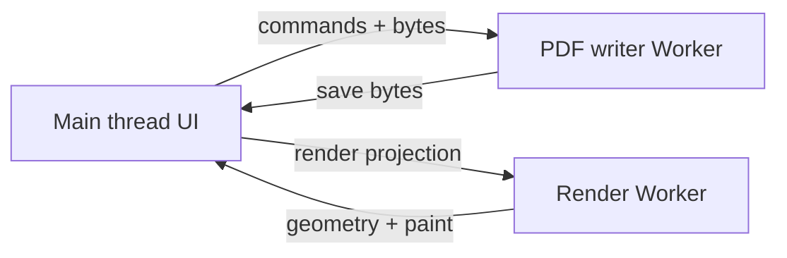

# PDFium WASM worker isolation (G1-PDF-04)

Native PDF writing uses a **separate** WASM module from the read-only render engine (`domdoc_engine`). Heaps, linear memory, and exported handles must never cross workers.

## Process model

| Worker | Module | Owns |
| --- | --- | --- |
| Render | `domdoc-wasm` / `domdoc_engine` | Layout, paint, geometry decode |
| PDF writer | `domdoc-pdfium-wasm` (C24 build) | PDFium `FPDF_*` handles, edit scratch |

## Message contract (writer worker)

1. **`pdf-writer/init`** — `{ moduleUrl, pdfiumSourceCommit, pdfiumRenderCommit }`; worker dynamic-imports the vendored package once.
2. **`pdf-writer/preflight`** — `{ bytes, checkpoint }` → capabilities + page count (no render projection).
3. **`pdf-writer/apply`** — `{ contextId, operations, expectedRevision }` → apply outcome; operations classified via `classifyPdfProofOperation` (P01–P05 hooks).
4. **`pdf-writer/save`** / **`pdf-writer/dispose`** — lifecycle (P12).

Render worker messages stay on existing `render-wire-v1` schema; do not embed PDF bytes in render requests.

## Build / fetch

- Pin and licence: [pdfium-wasm-pin.md](./pdfium-wasm-pin.md).
- Local artifact ingest: `PDFIUM_WASM_ARTIFACT_DIR=/path/to/built/pkg pnpm fetch:pdfium-wasm`.
- **This session:** C24 PDFium WASM binary is not vendored in-repo; evidence remains **stub-not-run** until Origin/CI hosts the artifact.

## Failure modes

- **Module missing:** backend `backend-not-configured`; gate **not-run**.
- **Module loaded, edits unimplemented:** `partial-run-not-implemented` with P01–P05 fixture id in message; gate **not-run**.
- **Cross-worker handle leak:** forbidden by design; writer worker terminates on protocol violation.
